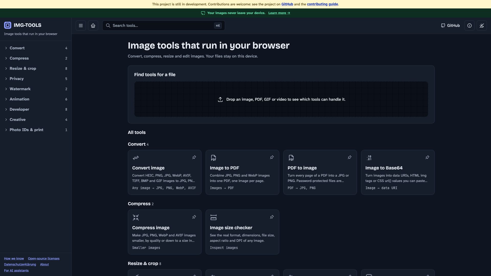

# IMG-TOOLS

Free image tools that run in your browser: convert, compress, resize, crop, remove metadata and more, with nothing uploaded.

Live site: **[https://img-tools.fyi](https://img-tools.fyi)**



## Why

- Nothing leaves your device. All processing happens in your browser, in web workers. There is no server code.
- Works offline once a tool page has loaded.
- No account, no sign-up and no cookies.
- Open source (MIT) and free.

## What you can do

40 tools in nine groups. Each name links to the live tool.

### Convert

- [Convert image](https://img-tools.fyi/convert-image/): Convert HEIC, PNG, JPG, WebP, AVIF, TIFF, BMP and GIF images to JPG, PNG, WebP or AVIF.
- [Image to PDF](https://img-tools.fyi/image-to-pdf/): Combine JPG, PNG and WebP images into one PDF, one image per page.
- [PDF to image](https://img-tools.fyi/pdf-to-image/): Turn every page of a PDF into a JPG or PNG. Password-protected files are supported.
- [Image to Base64](https://img-tools.fyi/image-to-base64/): Turn images into data URIs, HTML img tags or CSS url() values you can paste into code.

### Compress

- [Compress image](https://img-tools.fyi/compress-image/): Make JPG, PNG, WebP and AVIF images smaller, by quality or down to a size in KB.
- [Image size checker](https://img-tools.fyi/image-size-checker/): See the real format, dimensions, file size, aspect ratio and DPI of any image.

### Resize & crop

- [Resize image](https://img-tools.fyi/resize-image/): Change the size of JPG, PNG, WebP and AVIF images by longest edge, exact size or percent.
- [Crop image](https://img-tools.fyi/crop-image/): Crop images to a rectangle, circle or oval, with ratios and exact pixel values.
- [Bulk crop](https://img-tools.fyi/bulk-crop/): Crop the same part from many images at once, whatever their sizes.
- [Social media image resizer](https://img-tools.fyi/social-media-resizer/): Make one picture fit the image sizes of Instagram, X, LinkedIn, YouTube and Facebook.
- [Resize to cm or mm](https://img-tools.fyi/resize-to-cm/): Size photos for printing in cm, mm or inches, with the print resolution stored in the file.
- [Rotate & flip](https://img-tools.fyi/rotate-image/): Turn images in 90° steps and flip them left to right or top to bottom.
- [Add border](https://img-tools.fyi/add-border/): Add a colored or transparent border around images. Nothing is cropped.
- [Photo collage](https://img-tools.fyi/photo-collage/): Put several photos into one picture, in a grid with a gap, margin and background color.

### Privacy

- [EXIF viewer](https://img-tools.fyi/exif-viewer/): See the camera, exposure, date and location details hidden inside a photo.
- [Remove EXIF data](https://img-tools.fyi/remove-exif/): Remove location, camera details, dates and color profiles from photos.
- [Photo GPS extractor](https://img-tools.fyi/gps-extractor/): List where photos were taken, and export the locations as CSV or GPX.
- [Blur faces & areas](https://img-tools.fyi/blur-face/): Blur or pixelate faces, plates and other areas, in boxes or ovals you choose.
- [Redact image](https://img-tools.fyi/redact-image/): Paint solid boxes over private parts of a picture, so they cannot be recovered.

### Watermark

- [Add watermark](https://img-tools.fyi/add-watermark/): Put your text or logo on pictures, in the place you choose, at a size that fits each one.
- [Tiled watermark](https://img-tools.fyi/tiled-watermark/): Repeat your text or logo across the whole picture, so there is no clean corner to crop.

### Animation

- [GIF maker](https://img-tools.fyi/gif-maker/): Turn pictures into an animated GIF. Set the order, the delay, the colors and the looping.
- [Video to GIF](https://img-tools.fyi/video-to-gif/): Turn a short part of a video into an animated GIF. Choose the start, end, size and speed.
- [GIF to frames](https://img-tools.fyi/gif-to-frames/): Split an animated GIF into its frames and save them as PNG pictures.
- [Compress GIF](https://img-tools.fyi/compress-gif/): Make an animated GIF smaller with fewer colors, fewer frames or a smaller size.
- [Resize GIF](https://img-tools.fyi/resize-gif/): Change the size of an animated GIF without touching its timing or colors.
- [GIF to MP4](https://img-tools.fyi/gif-to-mp4/): Turn an animated GIF into a much smaller MP4 video.

### Developer

- [Favicon generator](https://img-tools.fyi/favicon-generator/): Make every favicon and web app icon a site needs from one picture, with the HTML to use them.
- [App icon generator](https://img-tools.fyi/app-icon-generator/): Make iOS and Android app icons in every size from one picture, ready to drop into your project.
- [Social preview image](https://img-tools.fyi/og-image-generator/): Design the 1200 × 630 image that shows when a link is shared. Pick a template, add your words.
- [Color palette extractor](https://img-tools.fyi/color-palette/): Find the main colors of a picture, with hex, RGB and HSL values you can copy.
- [Color picker](https://img-tools.fyi/color-picker/): Click anywhere on a picture to read the exact color as hex, RGB and HSL.
- [SVG optimizer](https://img-tools.fyi/svg-optimizer/): Make SVG files smaller by removing editor leftovers and extra detail. The picture looks the same.
- [Sprite sheet generator](https://img-tools.fyi/sprite-sheet/): Combine many small images into one sprite sheet, with the CSS to use each one.
- [BlurHash placeholder](https://img-tools.fyi/blurhash-generator/): Make a tiny BlurHash text, CSS gradient or data URI that stands in for an image while it loads.

### Creative

- [Meme maker](https://img-tools.fyi/meme-generator/): Put top and bottom text on a picture, in the classic bold style with an outline.
- [Screenshot frame](https://img-tools.fyi/screenshot-beautifier/): Put a screenshot in a window frame on a gradient, with rounded corners and a soft shadow.
- [Text on image](https://img-tools.fyi/text-on-image/): Add text to a picture. Use as many layers as you like, with fonts, colors and shadows.
- [Photo filters](https://img-tools.fyi/photo-filters/): Give a photo a look: warm, cool, vintage, moody, vivid or black and white. Fine-tune and save.

### Photo IDs & print

- [Passport photo maker](https://img-tools.fyi/passport-photo/): Make a passport or ID photo at 300 DPI, or a print sheet with copies.

## Privacy

- Every tool runs in your browser. Files are never uploaded.
- The site sets no cookies and loads no remote fonts or scripts.
- The live site counts usage with Umami Cloud (EU servers), without cookies: which tools are used, plus coarse settings such as the output format. It never sends file names, contents or sizes, and counting is off (the script is not even loaded) when your browser sends Do Not Track or Global Privacy Control. You can also block the request in your browser. Self-hosted builds have no analytics unless you turn them on.
- You can check it yourself: open the browser's network panel, or go offline after a tool has loaded and it keeps working.

Details: [English explanation](https://img-tools.fyi/privacy/) and [German privacy notice (Datenschutzerklärung)](https://img-tools.fyi/datenschutz/).

## How it works

- A static SvelteKit site: every page is prerendered, and there is no server code.
- Each tool is one folder in `src/tools/<slug>/`. The sidebar, routes, sitemap and `llms.txt` are generated from those folders.
- Heavy work runs in web workers, with WebAssembly codecs for HEIC, AVIF, WebP, PNG and PDF.
- CI enforces the promises: a strict Content Security Policy, a source scan that blocks network calls and HTML injection, a license allow-list and size budgets.

## Self-hosting

```sh
npm ci
npm run build
```

Copy the `build/` folder to any static web host, including a NAS web station. The build uses relative paths, so it works at the root or in any sub-folder, and needs no server configuration.

Analytics are off unless you set these variables when building:

| Variable                   | Meaning                                           |
| -------------------------- | ------------------------------------------------- |
| `PUBLIC_UMAMI_WEBSITE_ID`  | Your Umami website ID                             |
| `PUBLIC_UMAMI_HOST_URL`    | Your Umami Cloud (or self-hosted) collection host |
| `PUBLIC_UMAMI_DOMAINS`     | Comma-separated hostnames allowed to send         |
| `PUBLIC_ANALYTICS_CONSENT` | `opt-out` (default) or `opt-in`                   |

If you host a public copy, replace the German privacy notice (`src/routes/datenschutz/`) with your own: it names this site's operator.

## Develop

Needs Node 26.

```sh
npm ci
npx playwright install chromium   # once, for the e2e tests
npm run dev       # development server
npm run check     # formatting, types, Svelte warnings, source scan
npm test          # unit tests
npm run build     # license check, production build, size budgets
npm run e2e       # Playwright against the build (BROWSERS=all adds Firefox and WebKit)
```

`npm run e2e` tests the output of `npm run build`, so build first. A few e2e tests compare results with ffmpeg, qpdf and exiftool and are skipped when those are not installed.

## Status and known issues

Version 0.1.0, the first public release (see [CHANGELOG.md](CHANGELOG.md)). All 40 tools work and are tested with Playwright in Chromium, Firefox and WebKit. Open points:

- Safari, iOS and Android have not been tested on real devices yet.
- Firefox ignores the bitrate setting of GIF to MP4.
- Some preset data (passport, social and icon sizes) still has gaps, marked `MISSING:` in `src/lib/data/`.

## Contributing

Help is welcome, and much of it needs no code:

- **Report a file that fails.** [Open an issue](https://github.com/yexner/img-tools/issues/new/choose) with the tool, your browser and the file type.
- **Test on a real device.** A short report from Safari, an iPhone or an Android phone closes the biggest gap above.
- **Fill a data gap.** Each `MISSING:` value needs an official source.
- **Suggest or build a tool.** Open an issue first; a tool is one folder, and the site picks it up.

[CONTRIBUTING.md](CONTRIBUTING.md) has the setup, the rules and how to add a tool.

## Credits

Inspired by the amazingly helpful [it-tools.tech](https://it-tools.tech). No code or assets from that project are used.

Key libraries: [SvelteKit](https://svelte.dev) and Svelte, [libheif-js](https://github.com/catdad-experiments/libheif-js) (HEIC decoding), [@jSquash](https://github.com/jamsinclair/jSquash) (AVIF, WebP and PNG codecs), [mediabunny](https://mediabunny.dev) (video), [pdf.js](https://mozilla.github.io/pdf.js/) (PDF), [exifr](https://github.com/MikeKovarik/exifr) (metadata), [UTIF2](https://github.com/photopea/UTIF.js) (TIFF), [gifenc](https://github.com/mattdesl/gifenc) and [gifuct-js](https://github.com/matt-way/gifuct-js) (GIF), [SVGO](https://github.com/svg/svgo) (SVG), [fflate](https://github.com/101arrowz/fflate) and [BlurHash](https://github.com/woltapp/blurhash). Full list: [THIRD_PARTY_NOTICES.md](THIRD_PARTY_NOTICES.md).

HEIC decoding uses libheif-js, an unmodified LGPL library; see the notices file.

## License

MIT. See [LICENSE](LICENSE) and [THIRD_PARTY_NOTICES.md](THIRD_PARTY_NOTICES.md).
